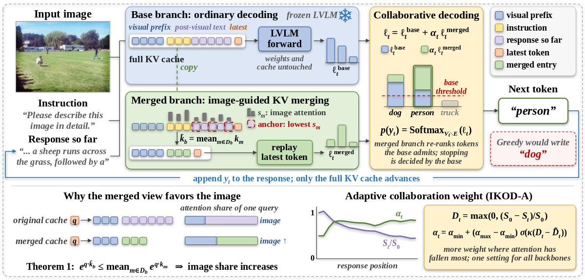
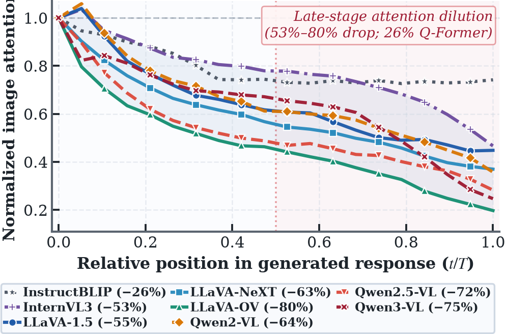
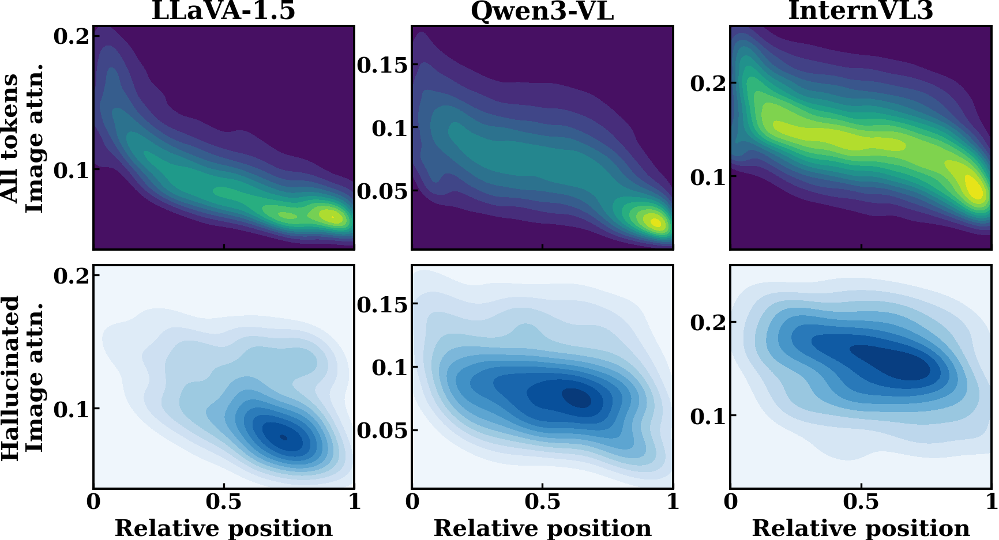
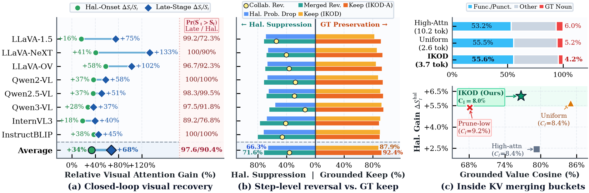

<div align="center">

# IKOD: Image-Attention-Guided Key-Value Merging against Object Hallucination in the Decoding of Large Vision-Language Models

A **training-free, model-agnostic** collaborative decoding framework for Large Vision-Language Models (LVLMs) that counters progressive **Visual Attention Dilution** by compressing low-visual-attention post-visual text intervals within the native KV cache — requiring *no fine-tuning, no input perturbations, and no external models*.

[**\[📄Paper (arXiv)\]**](https://arxiv.org/abs/2508.03469) &nbsp;&nbsp; [**\[🔌Integration Guide\]**](integrations/README.md) &nbsp;&nbsp; [**\[🌏简体中文\]**](README_zh.md)

[](#--model-overview)
[-21918c?style=flat-square)](#--experimental-results)
[](#--experimental-results)
[](LICENSE.md)

</div>

---

## 🔥 News

* **`2026.11`** 🌟 **IKOD & IKOD-A** expanded release covering **8 primary LVLMs (7B–8B)** and **4 large-scale backbones (13B–32B)** across **POPE, CHAIR, AMBER, MME, MMBench, MMStar, and MM-Vet**, together with closed-loop mechanistic verification suites and lossless acceleration (`1.14×` Greedy latency).
* **`2025.08`** 📄 Initial preprint released on [arXiv (2508.03469)](https://arxiv.org/abs/2508.03469).

## 👀 Contents

- [Model Overview](#-model-overview)
- [Quick Start & Integration](#-quick-start--integration)
- [Evaluation & Mechanistic Probes](#-evaluation--mechanistic-probes)
- [Experimental Results](#-experimental-results)
- [Repository Layout](#-repository-layout)
- [Acknowledgement](#-acknowledgement)
- [Citation](#-citation)

## 📋 Model Overview



Analyzing generation dynamics across eight diverse LVLMs across four architecture families (LLaVA, Qwen-VL, InternVL, and InstructBLIP), we uncover three empirical regularities driving object hallucination:
1. **Progressive Visual Attention Dilution (Proposition 1)**: As autoregressive generation proceeds, every appended text token adds a positive exponential term to the softmax denominator, monotonically eroding the total visual attention share $S_t$ so that hallucinated objects emerge significantly later and under lower visual attention than grounded mentions.
2. **Recoverability via Post-Visual KV Merging (Theorem 1)**: Merging contiguous post-visual text KV intervals centered at the lowest-visual-attention anchors into length-reduced bucket centroids strictly eliminates $P - n_t$ competing denominator terms and provably restores visual attention share ($S'_t > S_t$) whenever the mean attention mass per merged bucket stays below that of the merged region.
3. **Cross-Layer and Cross-Head Prevalence**: Visual attention dilution spans middle-to-deep decoder layers and heads, motivating full-layer KV-cache restructuring rather than heuristic layer subset selection.

<div align="center">
  
  
</div>

Building on these insights, **IKOD** performs dual-branch collaborative decoding at only **1.14×** single-pass runtime:
- **1. Anchor Selection**: Ranks mergeable post-visual text positions $[u+U, u+U+P)$ by their cumulative visual attention $s_m$ and selects the $n_t = \lfloor \lambda P \rfloor$ lowest-attention positions (predominantly function words and punctuation) as anchors.
- **2. Partition-and-Average KV Merging**: Partitions the post-visual region into $n_t$ contiguous intervals around the anchors and averages each bucket into a compact centroid $(\tilde{\boldsymbol{k}}_b, \tilde{\boldsymbol{v}}_b)$ while keeping all $U$ visual tokens and the latest query token intact.
- **3. Plausibility-Gated Collaborative Fusion**: Fuses the base logits $\boldsymbol{\ell}_t^{\text{base}}$ and auxiliary merged-branch logits $\boldsymbol{\ell}_t^{\text{merged}}$ within the plausible candidate set $\mathcal{V}_t(\beta)$:
  $$\tilde{\boldsymbol{\ell}}_t(y) = \boldsymbol{\ell}_t^{\text{base}}(y) + \alpha_t\,\boldsymbol{\ell}_t^{\text{merged}}(y), \quad y \in \mathcal{V}_t(\beta).$$
- **4. Online Attention-Decay Gate (IKOD-A)**: Schedules $\alpha_t = \alpha_{\min} + (\alpha_{\max}-\alpha_{\min})\sigma(\kappa(D_t - \tilde{D}_t))$ online from the measured visual attention drop $D_t = \max(0, (S_0 - S_t)/S_0)$ under a single universal hyperparameter configuration across all models and tasks.

## 🔧 Quick Start & Integration

**Requirements**: Python $\ge$ 3.10, PyTorch $\ge$ 2.1, `transformers >= 4.45.0`. Install dependencies via:

```bash
pip install -r requirements.txt
```

Run **IKOD** or tuning-free **IKOD-A** on any supported HuggingFace LVLM in a few lines of Python:

```python
import torch
from PIL import Image
from ikod import ikod_generate
from ikod.models import load_vlm

model, processor = load_vlm("llava_15_hf", device="cuda", dtype=torch.bfloat16)
image = Image.open("demo.jpg").convert("RGB")
prompt = "USER: <image>\nPlease describe this image in detail.\nASSISTANT:"
inputs = processor(text=prompt, images=image, return_tensors="pt").to("cuda")

# 1. IKOD (Fixed family-level collaborative weight)
out_ikod = ikod_generate(
    model,
    input_ids=inputs["input_ids"],
    pixel_values=inputs["pixel_values"],
    ratio=0.4,          # lambda: retained post-visual KV ratio
    alpha=4.0,          # collaborative fusion strength
    beta=0.1,           # plausibility threshold
    max_new_tokens=512,
)

# 2. IKOD-A (Universal tuning-free online attention-decay gate)
out_ikoda = ikod_generate(
    model,
    input_ids=inputs["input_ids"],
    pixel_values=inputs["pixel_values"],
    ratio=0.4,
    adaptive="p1",      # online decay schedule (alpha_min=0, alpha_max=1, kappa=10)
    beta=0.1,
    max_new_tokens=512,
)
print(processor.decode(out_ikod[0], skip_special_tokens=True))
```

See [`integrations/README.md`](integrations/README.md) for per-family hyperparameters, environment switches, and 13B–32B zero-shot transfer settings.

## 🧪 Evaluation & Mechanistic Probes

```bash
# 1. Hallucination Benchmarks (POPE, CHAIR-512 / 128, AMBER)
python eval/eval_pope.py --model llava_15_hf --dataset coco --split adversarial --method ikod
python eval/eval_chair.py --model llava_15_hf --max_new 512 --ratio 0.4 --alpha 4.0
python eval/score_chair.py --cap_file results/chair_llava_15_hf_ikod.jsonl
python eval/eval_amber.py --model llava_15_hf --mode all --method ikod

# 2. General Multimodal Benchmarks (MME, MMBench, MMStar, MM-Vet via lmms-eval)
python eval/eval_general.py --model llava_15_hf --tasks mme,mmbench_en_dev,mmstar,mmvet

# 3. Mechanistic Verification & Forward-Pass Probes (Figs. 1-3, Fig. 6, Table XII)
python analysis/probe_fading_focus.py           # Fig. 1: Position-wise visual attention decay
python analysis/probe_attn_density.py           # Fig. 2: Attention density & top-1 agreement
python analysis/probe_closed_loop_8b.py         # Fig. 6 & Table XII: 8-LVLM Theorem 1 verification
python analysis/profile_efficiency.py           # Table X & XVIII: Latency & peak GPU memory profiler
```

## 📈 Experimental Results

### 1. Object Hallucination & General Multimodal Benchmarks (8 LVLMs)

Evaluated across **8 primary LVLMs** (*LLaVA-1.5-7B*, *LLaVA-NeXT-7B*, *LLaVA-OneVision-7B*, *Qwen2-VL-7B*, *Qwen2.5-VL-7B*, *Qwen3-VL-8B*, *InternVL3-8B*, and *InstructBLIP-7B*) against **7 training-free decoding baselines** (*VCD, M3ID, OPERA, ICD, SID, AGLA, ReVisiT*):

| Method | POPE Acc.$\uparrow$ | POPE F1$\uparrow$ | CHAIR $C_S\downarrow$ | CHAIR $C_I\downarrow$ | CHAIR F1$\uparrow$ | AMBER Chair$\downarrow$ | AMBER F1$\uparrow$ | MME$\uparrow$ | MMB$\uparrow$ | Latency (ms/tok)$\downarrow$ | Speed$\downarrow$ |
|---|---:|---:|---:|---:|---:|---:|---:|---:|---:|---:|---:|
| Greedy | 86.78 | 86.09 | 38.4 | 10.6 | 76.9 | 7.8 | 82.9 | 1986.1 | 75.5 | 24.3 | 1.00$\times$ |
| VCD (*CVPR'24*) | 86.38 | 85.94 | 39.6 | 11.1 | 76.4 | 8.1 | 82.4 | 1957.9 | 74.8 | 47.7 | 1.97$\times$ |
| M3ID (*CVPR'24*) | 86.17 | 85.79 | 40.3 | 11.3 | 76.1 | 8.4 | 82.1 | 1951.3 | 74.6 | 46.8 | 1.92$\times$ |
| OPERA$^{\ast}$ (*CVPR'24*) | 86.88 | 86.18 | 37.8 | 10.4 | 76.8 | 7.6 | 82.8 | 1978.4 | 75.2 | 253.6 | 10.67$\times$ |
| ICD (*ECCV'24*) | 86.45 | 85.85 | 39.2 | 10.9 | 76.5 | 7.9 | 82.5 | 1962.0 | 74.9 | 48.0 | 1.98$\times$ |
| SID (*ICLR'25*) | 86.64 | 86.05 | 38.5 | 10.7 | 76.7 | 7.7 | 82.7 | 1970.8 | 75.1 | 49.6 | 2.04$\times$ |
| AGLA (*ICLR'25*) | 87.02 | 86.39 | 37.4 | 10.2 | 76.8 | 7.4 | 83.1 | 1979.5 | 75.3 | 49.7 | 2.05$\times$ |
| ReVisiT (*EMNLP'25*) | 86.85 | 86.16 | 38.1 | 10.5 | 76.9 | 7.7 | 82.9 | 1983.2 | 75.4 | 25.5 | 1.05$\times$ |
| **IKOD (Ours)** | **87.64** | **87.26** | **31.7** | **8.0** | **77.3** | **6.1** | **84.2** | **1999.2** | **75.7** | 27.6 | 1.14$\times$ |
| **IKOD-A (Ours)** | \underline{87.31} | \underline{86.81} | \underline{35.1} | \underline{9.0} | **77.9** | \underline{6.6} | \underline{83.8} | \underline{1993.8} | **75.7** | 27.8 | 1.15$\times$ |

### 2. Closed-Loop Mechanistic Verification & Qualitative Grounding

<div align="center">
  
</div>

Across **801,118 CHAIR decoding steps** over all eight LVLMs, Theorem 1 ($S'_t > S_t$) holds on **97.6%** of late generation steps ($t \ge T/2$) and **90.4%** of hallucination-onset steps, lifting mean late visual attention by **+67.5% relative** (`13.8%` $\rightarrow$ `21.5%`) and cutting hallucinated-noun probability by **66.3% relative** while preserving **87.9%** (IKOD) and **92.4%** (IKOD-A) of grounded object predictions.

## 🗂️ Repository Layout

```text
IKOD/
├── ikod/                   # Core IKOD & IKOD-A package (decode, kv_merge, adaptive, image_span, models)
├── integrations/           # Per-backbone wiring guide, hyperparameter tables, and environment switches
├── eval/                   # Evaluation runners and scorers for POPE, CHAIR, AMBER, and general benchmarks
├── analysis/               # Mechanistic forward-pass probes and Theorem 1 closed-loop verification
└── figures/                # Paper figure plotting scripts and high-resolution visual assets
```

## 🙏 Acknowledgement

We thank the open-source communities behind
[LLaVA](https://github.com/haotian-liu/LLaVA) ·
[Qwen-VL](https://github.com/QwenLM/Qwen2.5-VL) ·
[InternVL](https://github.com/OpenGVLab/InternVL) ·
[LAVIS / InstructBLIP](https://github.com/salesforce/LAVIS) ·
[lmms-eval](https://github.com/EvolvingLMMs-Lab/lmms-eval) ·
[VCD](https://github.com/DAMO-NLP-SG/VCD) ·
[OPERA](https://github.com/shikiw/OPERA).

This repository is released under the **MIT License** (see [`LICENSE.md`](LICENSE.md)).

## 📝 Citation

If you find IKOD useful for your research, please consider citing our paper:

```bibtex
@article{yang2025ikod,
  title   = {IKOD: Image-Attention-Guided Key-Value Merging against Object Hallucination in the Decoding of Large Vision-Language Models},
  author  = {Yang, Jiabing and Cui, Chenhang and Chen, Yixiang and Yu, Tao and Huang, Yan and Wang, Liang},
  journal = {arXiv preprint arXiv:2508.03469},
  year    = {2025}
}
```
