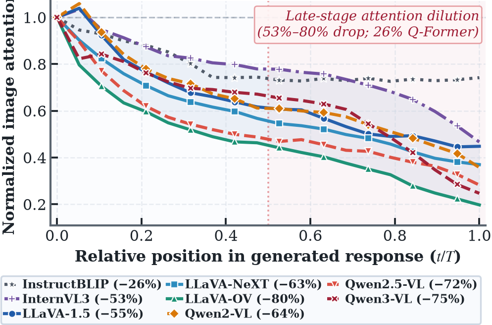
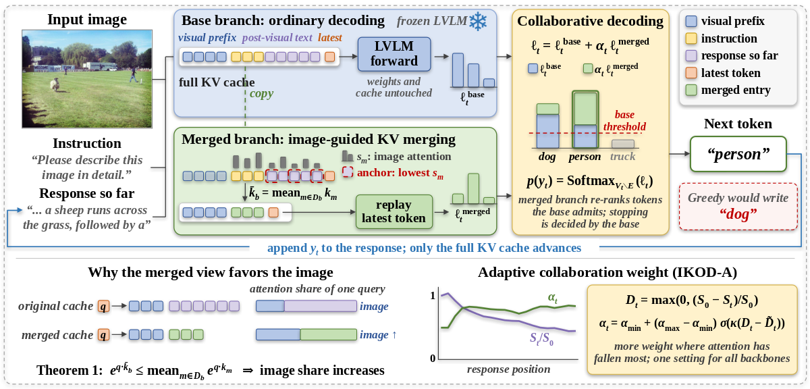
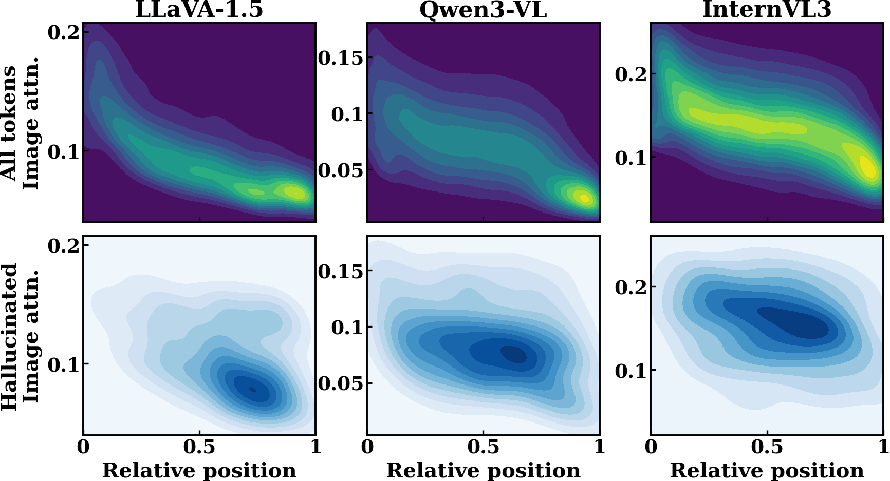
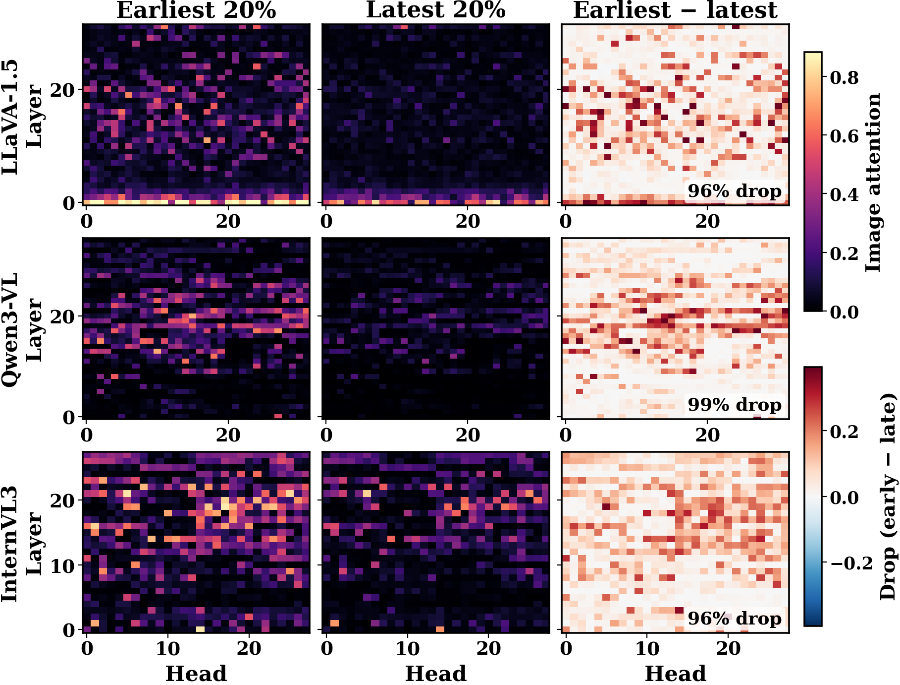
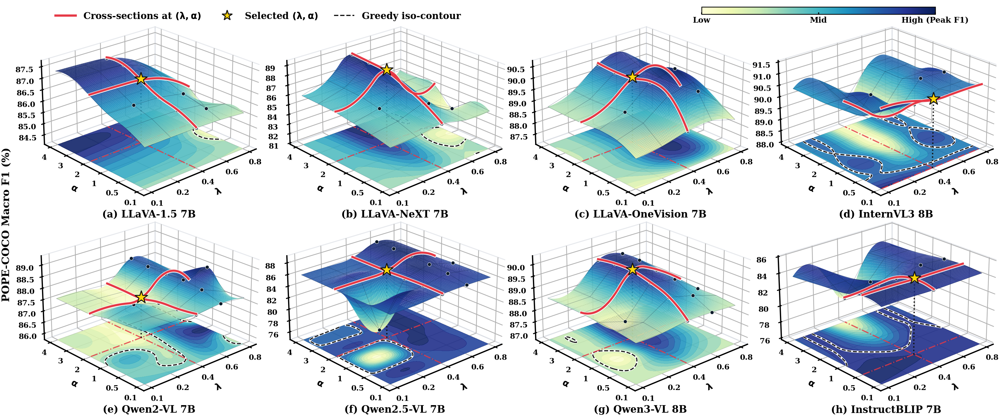
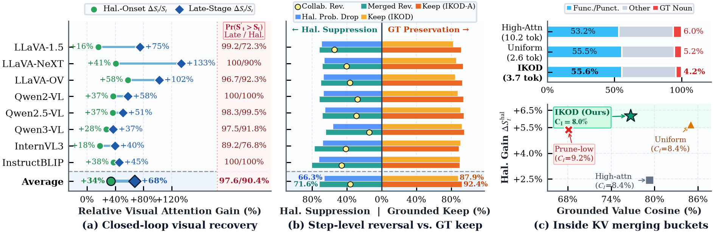
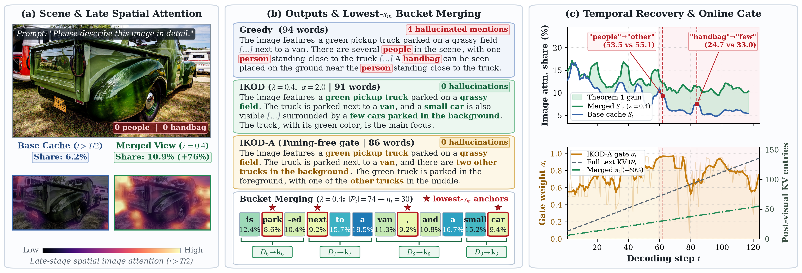
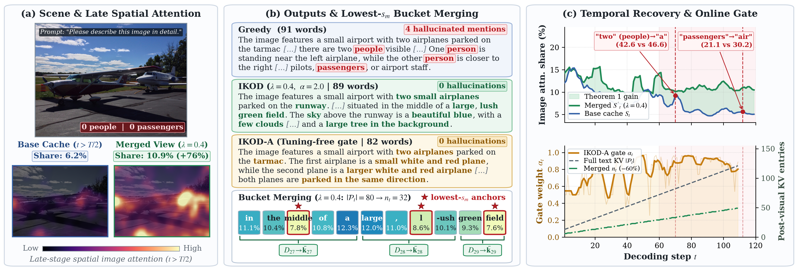
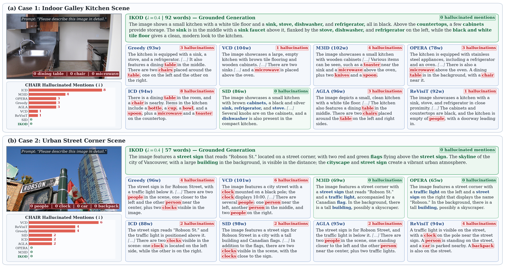

<div align="center">

# IKOD：面向大型视觉语言模型解码阶段物体幻觉抑制的图像注意力引导键值融合方法

<p align="center">
  <a href="https://arxiv.org/abs/2508.03469"></a>
  <a href="https://github.com/jiabingyang01/IKOD"></a>
  <a href="LICENSE.md"></a>
  <a href="README.md"></a>
</p>

**Jiabing Yang<sup>*</sup>, Chenhang Cui<sup>*</sup>, Yixiang Chen, Tao Yu, Yan Huang<sup>†</sup>, and Liang Wang, *Fellow, IEEE***

***IKOD** 与 **IKOD-A** 官方 PyTorch 开源实现*

</div>

---

## 📖 研究背景与核心动机

大型视觉语言模型（LVLM）在自回归生成过程中容易产生不存在于输入图像中的物体幻觉。现有免训练解码方法大多仅在**输出词表 Logits 层**通过对比解码（如 VCD、M3ID、ICD、SID、AGLA）或束搜索回溯（OPERA）进行事后修正，却未能触及模型内部注意力的退化根源：**随着生成文本不断累积，自注意力质量逐渐被历史生成文本稀释，视觉注意力份额持续衰减（Fading Visual Focus）**，导致生成中后期的词元愈发依赖语言先验而非视觉证据。

<p align="center">
  
</p>

为直接从键值缓存（KV Cache）层面解决这一根源问题，本文提出免训练协同解码框架 **IKOD**（**I**mage-Attention-Guided **K**ey–Value Merging against **O**bject Hallucination in **D**ecoding）及其无超参自适应变体 **IKOD-A**：

1. **图像注意力引导的视觉后锚点选择**：在每个解码步，IKOD 统计各视觉后文本位置跨层累积的图像注意力份额 <i>s<sub>m</sub></i>，选取图像注意力最低的文本位置作为锚点（<i>n<sub>t</sub></i> = ⌈<i>λ</i> · <i>P<sub>t</sub></i>⌉），并将视觉后文本序列围绕锚点划分为连续的局部桶（Buckets）。
2. **可证明恢复视觉注意力的 KV 桶均值融合（定理 1）**：IKOD 将每个局部桶内的键值向量均值融合为桶质心（<i>D<sub>b</sub></i> → <i>k̃<sub>b</sub></i>, <i>ṽ<sub>b</sub></i>），构建紧凑的融合分支 KV 缓存，从理论上**严格保证融合后 Softmax 总视觉注意力份额单调提升（<i>S'<sub>t</sub></i> > <i>S<sub>t</sub></i>）**，并在合理性约束下与基础分支进行协同 Logits 融合。
3. **免调参在线衰减门控（IKOD-A）**：通过实时监测当前步视觉注意力相对于初始前缀水平的相对衰减率 <i>D<sub>t</sub></i> 及其滑动中位数 <i>D̃<sub>t</sub></i>，**IKOD-A** 以闭式解在线动态调节协同权重 <i>α<sub>t</sub></i>，无需针对不同模型单独调参。

<p align="center">
  
</p>

---

## ✨ 核心亮点

- **跨 8 大主流 LVLM 架构的一致幻觉抑制**：在 **LLaVA-1.5-7B、LLaVA-NeXT-7B、LLaVA-OneVision-7B (LLaVA-OV)、Qwen2-VL-7B、Qwen2.5-VL-7B、Qwen3-VL-8B、InternVL3-8B、InstructBLIP-7B** 八大模型上，IKOD 将 8 模型平均 CHAIR 实例级幻觉率 <i>C<sub>I</sub></i> 从 **10.1% 降至 8.0%**，句子级幻觉率 <i>C<sub>S</sub></i> 从 **36.9% 降至 32.4%**，同时将 POPE 平均 F1 提升至 **87.97%**、CHAIR F1 提升至 **77.6%**。
- **零样本跨尺度泛化（13B–32B）**：将 7B/8B 超参直接零样本迁移至 **LLaVA-1.5-13B、InstructBLIP-13B、InternVL3-14B、Qwen2.5-VL-32B**，在 CHAIR 与 POPE 上全面超越贪婪解码基线。
- **通用多模态能力零退化**：在 **AMBER、MME 感知（MME<sup>P</sup>）、MMStar（MMS）、MMBench-EN（MMB）、ScienceQA-IMG（SQA）** 等综合基准上保持高度稳健的通用视觉问答与推理性能。
- **极低推理开销（仅 1.14× Greedy 延迟 vs. 对比解码 ~2.0× / OPERA 10.67×）**：结合合理性集合单元素短路机制（无损跳过约 38% 解码步）与持久化视觉前缀缓冲区复用，IKOD 平均每词元耗时仅 **27.6 ms**（1.14× Greedy），显著快于双前向对比基线（46.8–49.7 ms/tok）与 5 束搜索 OPERA（253.6 ms/tok）。

---

## 📊 完整实验结果总览

### 1. 8 模型平均综合性能对比

| 方法 | 发表会议 | 核心机制 | 相对延迟 (vs. Greedy) | POPE F1 ↑ | CHAIR C<sub>S</sub> ↓ | CHAIR C<sub>I</sub> ↓ | CHAIR F1 ↑ | AMBER Attr ↑ | AMBER Hal ↓ |
| :--- | :---: | :---: | :---: | :---: | :---: | :---: | :---: | :---: | :---: |
| Greedy | — | 标准自回归贪婪解码 | 1.00× | 86.95 | 36.9 | 10.1 | 77.2 | 83.7 | 47.7 |
| VCD | *CVPR'24* | 噪声图像对比解码 | 1.97× | 87.60 | 40.3 | 11.9 | 75.9 | 83.1 | 52.6 |
| M3ID | *CVPR'24* | 无图像先验对比解码 | 1.92× | 86.96 | 37.9 | 10.9 | <u>77.5</u> | 83.1 | 48.7 |
| OPERA<sup>*</sup> | *CVPR'24* | 过度信任惩罚与回溯（5-Beam） | 10.67× | 87.14 | 35.6 | 9.6 | 75.3 | <u>84.0</u> | <u>44.1</u> |
| ICD | *ECCV'24* | 指令干扰对比解码 | 1.98× | 86.03 | 40.2 | 11.9 | 75.5 | 83.9 | 53.6 |
| SID | *ICLR'25* | 低注意力词元裁剪对比解码 | 2.04× | 87.03 | 39.2 | 11.5 | 76.7 | 83.4 | 49.4 |
| AGLA | *ICLR'25* | 全局-局部注意力对比解码 | 2.05× | 87.08 | 36.5 | 9.9 | 76.6 | 83.7 | 46.8 |
| ReVisiT | *EMNLP'25* | 视觉层注意力汇聚校准 | 1.05× | 85.48 | 36.8 | 10.2 | 76.9 | 82.8 | 47.8 |
| **IKOD (Ours)** | — | **图像注意力引导 KV 桶均值融合** | **1.14×** | **87.97** | **32.4** | **8.0** | 77.3 | 83.6 | **41.6** |
| **IKOD-A (Ours)** | — | **在线视觉衰减门控自适应 KV 融合** | **1.15×** | <u>87.62</u> | <u>34.2</u> | <u>9.2</u> | **77.6** | **84.1** | 45.4 |

---

### 2. POPE 基准 8 模型详细评测结果（Random / Popular / Adversarial / Mean — Table I）

| Model | Split / Metric | Greedy | VCD | M3ID | OPERA<sup>*</sup> | ICD | SID | AGLA | ReVisiT | **IKOD** | **IKOD-A** |
|:---|---:|---:|---:|---:|---:|---:|---:|---:|---:|---:|---:|
| LLaVA-1.5 7B | *Random* | 86.95 | **89.06** | 85.10 | 87.21 | 85.53 | 85.83 | 86.99 | 85.50 | <u>88.90</u> | 87.70 |
| LLaVA-1.5 7B | *Popular* | 85.96 | <u>86.86</u> | 84.21 | 86.08 | 84.55 | 84.52 | 85.92 | 84.78 | **87.26** | 86.54 |
| LLaVA-1.5 7B | *Adversarial* | 84.02 | 83.41 | 82.21 | 84.03 | 83.01 | 82.54 | 84.08 | 82.79 | <u>84.32</u> | **84.35** |
| LLaVA-1.5 7B | *Average* | 85.64 | <u>86.45</u> | 83.84 | 85.77 | 84.36 | 84.30 | 85.67 | 84.36 | **86.82** | 86.20 |
| LLaVA-NeXT 7B | *Random* | 85.57 | <u>89.01</u> | 86.25 | 86.28 | 83.19 | 87.17 | 86.40 | 85.60 | **89.50** | 87.68 |
| LLaVA-NeXT 7B | *Popular* | 84.64 | <u>87.11</u> | 85.26 | 85.26 | 82.42 | 86.08 | 85.47 | 84.54 | **88.42** | 86.59 |
| LLaVA-NeXT 7B | *Adversarial* | 83.84 | <u>85.72</u> | 84.38 | 84.41 | 81.78 | 84.93 | 84.71 | 83.68 | **86.67** | 85.44 |
| LLaVA-NeXT 7B | *Average* | 84.68 | <u>87.28</u> | 85.30 | 85.32 | 82.46 | 86.06 | 85.53 | 84.61 | **88.20** | 86.57 |
| LLaVA-OV 7B | *Random* | 89.32 | <u>92.68</u> | 90.05 | 89.76 | 89.28 | 89.78 | 89.58 | 88.04 | **93.23** | 91.68 |
| LLaVA-OV 7B | *Popular* | 88.13 | **90.15** | 88.70 | 88.51 | 88.09 | 88.59 | 88.52 | 87.11 | 89.68 | <u>89.74</u> |
| LLaVA-OV 7B | *Adversarial* | 86.99 | <u>87.79</u> | 87.50 | 87.32 | 86.94 | 87.58 | 87.27 | 85.88 | 86.78 | **88.11** |
| LLaVA-OV 7B | *Average* | 88.15 | **90.20** | 88.75 | 88.53 | 88.10 | 88.65 | 88.46 | 87.01 | <u>89.90</u> | 89.84 |
| Qwen2-VL 7B | *Random* | 89.04 | 89.17 | **89.29** | <u>89.20</u> | 88.54 | 89.04 | 88.84 | 87.62 | 88.96 | 89.09 |
| Qwen2-VL 7B | *Popular* | 87.72 | 87.70 | **87.97** | <u>87.86</u> | 87.14 | 87.51 | 87.43 | 86.24 | 87.30 | 87.65 |
| Qwen2-VL 7B | *Adversarial* | 86.43 | <u>86.56</u> | **86.58** | 86.48 | 85.58 | 86.23 | 86.13 | 85.15 | 86.10 | 86.31 |
| Qwen2-VL 7B | *Average* | 87.73 | 87.81 | **87.95** | <u>87.85</u> | 87.09 | 87.59 | 87.47 | 86.34 | 87.45 | 87.68 |
| Qwen2.5-VL 7B | *Random* | 86.74 | 87.36 | <u>88.66</u> | 86.88 | 85.33 | **89.01** | 86.80 | 84.48 | 87.35 | 87.34 |
| Qwen2.5-VL 7B | *Popular* | 85.94 | 86.32 | <u>87.73</u> | 86.04 | 84.56 | **88.14** | 85.97 | 83.68 | 86.10 | 86.31 |
| Qwen2.5-VL 7B | *Adversarial* | 85.22 | 85.49 | **86.71** | 85.25 | 83.70 | <u>86.59</u> | 85.22 | 83.28 | 85.15 | 85.51 |
| Qwen2.5-VL 7B | *Average* | 85.97 | 86.39 | <u>87.70</u> | 86.06 | 84.53 | **87.92** | 86.00 | 83.81 | 86.20 | 86.39 |
| Qwen3-VL 8B | *Random* | 90.46 | <u>91.57</u> | 90.12 | 90.58 | 90.58 | 91.45 | 90.50 | 90.42 | **92.35** | <u>91.57</u> |
| Qwen3-VL 8B | *Popular* | 88.24 | 88.90 | 88.33 | 88.27 | 88.62 | 88.88 | 88.13 | 88.05 | **89.43** | <u>89.00</u> |
| Qwen3-VL 8B | *Adversarial* | 86.45 | 86.79 | 86.77 | 86.48 | 86.55 | <u>86.97</u> | 86.40 | 86.32 | **87.16** | 86.95 |
| Qwen3-VL 8B | *Average* | 88.39 | 89.09 | 88.40 | 88.44 | 88.58 | 89.10 | 88.34 | 88.27 | **89.65** | <u>89.17</u> |
| InternVL3 8B | *Random* | 93.92 | 93.74 | 93.85 | 93.99 | 93.88 | 94.15 | 94.00 | 93.99 | <u>94.22</u> | **94.61** |
| InternVL3 8B | *Popular* | 90.47 | 90.44 | **90.69** | 90.57 | 90.32 | 90.25 | 90.61 | **90.69** | <u>90.63</u> | 89.69 |
| InternVL3 8B | *Adversarial* | 87.41 | 87.59 | **88.17** | 87.53 | 87.06 | 87.02 | 87.43 | <u>87.89</u> | 87.40 | 86.49 |
| InternVL3 8B | *Average* | 90.60 | 90.59 | **90.90** | 90.69 | 90.42 | 90.47 | 90.68 | <u>90.86</u> | 90.75 | 90.26 |
| InstructBLIP 7B | *Random* | 86.98 | 85.28 | 84.71 | 86.99 | 84.37 | 83.86 | <u>87.07</u> | 83.02 | **87.88** | **87.88** |
| InstructBLIP 7B | *Popular* | 84.31 | 83.01 | 82.49 | 84.32 | 82.29 | 81.97 | <u>84.49</u> | 76.94 | **84.73** | **84.73** |
| InstructBLIP 7B | *Adversarial* | <u>82.13</u> | 80.80 | 81.27 | **82.17** | 81.31 | 80.74 | 82.05 | 75.77 | 81.85 | 81.85 |
| InstructBLIP 7B | *Average* | 84.47 | 83.03 | 82.82 | 84.49 | 82.66 | 82.19 | <u>84.53</u> | 78.58 | **84.82** | **84.82** |

---

### 3. CHAIR 开放式长描述幻觉基准 8 模型详细结果（Table II）

| Model | Split / Metric | Greedy | VCD | M3ID | OPERA<sup>*</sup> | ICD | SID | AGLA | ReVisiT | **IKOD** | **IKOD-A** |
|:---|---:|---:|---:|---:|---:|---:|---:|---:|---:|---:|---:|
| LLaVA-1.5 7B | C<sub>S</sub>↓ | 51.4 | 56.4 | 49.4 | **37.4** | 54.0 | 51.6 | 50.2 | 53.6 | <u>40.2</u> | 47.6 |
| LLaVA-1.5 7B | C<sub>I</sub>↓ | 15.9 | 17.0 | 15.5 | **12.3** | 16.8 | 15.0 | 15.6 | 16.1 | <u>12.5</u> | 14.3 |
| LLaVA-1.5 7B | Recall↑ | 77.8 | 77.2 | <u>77.9</u> | 74.3 | 76.6 | 75.7 | 77.1 | 76.6 | 76.1 | **79.3** |
| LLaVA-1.5 7B | F1↑ | 80.8 | 80.0 | 81.1 | 80.4 | 79.8 | 80.1 | 80.6 | 80.1 | <u>81.4</u> | **82.4** |
| LLaVA-1.5 7B | Words | 84.4 | 86.0 | 79.1 | 70.8 | 81.0 | 80.6 | 84.2 | 90.7 | 88.9 | 85.8 |
| LLaVA-NeXT 7B | C<sub>S</sub>↓ | 30.4 | 37.4 | 33.2 | <u>26.0</u> | 28.4 | 37.4 | 29.2 | 29.0 | **24.8** | 27.8 |
| LLaVA-NeXT 7B | C<sub>I</sub>↓ | 9.2 | 11.7 | 8.9 | 8.4 | 8.8 | 10.2 | 7.9 | <u>7.0</u> | **6.1** | 7.3 |
| LLaVA-NeXT 7B | Recall↑ | 61.1 | 63.9 | 65.3 | 59.5 | 60.4 | <u>65.6</u> | 59.8 | **66.0** | 60.9 | 60.8 |
| LLaVA-NeXT 7B | F1↑ | 73.0 | 74.1 | <u>76.1</u> | 72.1 | 72.7 | 75.8 | 72.5 | **77.2** | 73.9 | 73.4 |
| LLaVA-NeXT 7B | Words | 159.8 | 158.0 | 153.7 | 148.9 | 152.2 | 152.5 | 157.8 | 172.5 | 168.2 | 157.2 |
| LLaVA-OV 7B | C<sub>S</sub>↓ | 33.6 | 45.0 | 39.2 | 33.6 | 37.4 | 36.8 | 35.4 | <u>29.8</u> | **25.8** | 33.2 |
| LLaVA-OV 7B | C<sub>I</sub>↓ | 8.2 | 12.2 | 8.2 | 7.9 | 8.8 | 9.4 | 8.0 | 7.4 | <u>6.4</u> | **6.2** |
| LLaVA-OV 7B | Recall↑ | 65.7 | <u>66.2</u> | **66.9** | 62.3 | 64.5 | 64.8 | 65.4 | 64.0 | 59.7 | 64.6 |
| LLaVA-OV 7B | F1↑ | <u>76.6</u> | 75.5 | **77.4** | 74.3 | 75.6 | 75.6 | 76.5 | 75.7 | 72.9 | 76.5 |
| LLaVA-OV 7B | Words | 213.9 | 172.3 | 230.8 | 185.3 | 204.1 | 180.0 | 227.0 | 222.2 | 327.2 | 252.7 |
| Qwen2-VL 7B | C<sub>S</sub>↓ | 25.2 | **19.6** | 27.2 | <u>20.6</u> | 20.8 | 25.4 | 22.6 | 23.0 | 21.8 | 23.8 |
| Qwen2-VL 7B | C<sub>I</sub>↓ | 7.4 | 7.9 | 9.4 | 8.6 | <u>7.0</u> | 8.1 | 7.3 | 11.9 | **4.0** | 8.4 |
| Qwen2-VL 7B | Recall↑ | 66.9 | 54.6 | <u>67.2</u> | 63.6 | 59.4 | 61.7 | 65.9 | 66.5 | 66.3 | **68.6** |
| Qwen2-VL 7B | F1↑ | <u>77.7</u> | 68.6 | 77.2 | 75.0 | 72.5 | 73.8 | 77.0 | 75.8 | **78.4** | **78.4** |
| Qwen2-VL 7B | Words | 84.2 | 65.1 | 79.8 | 78.7 | 90.2 | 72.3 | 88.2 | 89.4 | 103.8 | 86.1 |
| Qwen2.5-VL 7B | C<sub>S</sub>↓ | 23.8 | 30.0 | 29.0 | **17.0** | 24.6 | 29.0 | 23.6 | <u>21.2</u> | 23.2 | 25.4 |
| Qwen2.5-VL 7B | C<sub>I</sub>↓ | <u>6.8</u> | 8.9 | 8.9 | 7.8 | 9.2 | 8.6 | 8.2 | 8.2 | **6.4** | 7.9 |
| Qwen2.5-VL 7B | Recall↑ | 57.5 | <u>58.0</u> | 57.7 | 47.9 | 55.5 | **58.6** | 54.9 | 52.4 | 56.9 | 56.5 |
| Qwen2.5-VL 7B | F1↑ | <u>71.1</u> | 70.9 | 70.7 | 63.0 | 68.9 | **71.4** | 68.7 | 66.7 | 70.8 | 70.0 |
| Qwen2.5-VL 7B | Words | 164.2 | 154.9 | 135.8 | 107.0 | 177.2 | 147.4 | 158.5 | 176.5 | 162.9 | 154.0 |
| Qwen3-VL 8B | C<sub>S</sub>↓ | 53.6 | 58.8 | 54.6 | **48.8** | 55.8 | 55.0 | 51.8 | 51.4 | 52.0 | <u>49.0</u> |
| Qwen3-VL 8B | C<sub>I</sub>↓ | 10.9 | 12.1 | 11.0 | 10.2 | 10.8 | 11.1 | 10.5 | 10.3 | **9.2** | <u>9.7</u> |
| Qwen3-VL 8B | Recall↑ | 74.5 | 75.4 | 74.5 | 74.1 | <u>75.6</u> | **76.2** | 74.7 | <u>75.6</u> | 75.0 | 74.4 |
| Qwen3-VL 8B | F1↑ | 81.1 | 81.2 | 81.1 | 81.2 | 81.8 | **82.1** | 81.4 | <u>82.0</u> | **82.1** | 81.6 |
| Qwen3-VL 8B | Words | 324.2 | 326.4 | 323.7 | 312.7 | 348.5 | 315.3 | 313.8 | 323.0 | 311.5 | 311.7 |
| InternVL3 8B | C<sub>S</sub>↓ | 30.4 | 32.4 | 30.8 | 27.2 | 30.2 | 33.6 | **25.8** | 30.4 | <u>27.0</u> | 27.4 |
| InternVL3 8B | C<sub>I</sub>↓ | 9.1 | 10.1 | 8.8 | 7.8 | 8.2 | 10.0 | 8.1 | 8.4 | <u>7.7</u> | **7.4** |
| InternVL3 8B | Recall↑ | 70.4 | 70.3 | <u>70.6</u> | 70.1 | 69.4 | 70.2 | 67.7 | **71.1** | 70.2 | 70.3 |
| InternVL3 8B | F1↑ | 79.3 | 78.9 | 79.6 | 79.6 | 79.0 | 78.9 | 78.0 | **80.1** | 79.7 | <u>79.9</u> |
| InternVL3 8B | Words | 104.9 | 104.4 | 103.8 | 103.7 | 111.4 | 105.7 | 100.6 | 105.2 | 106.9 | 114.8 |
| InstructBLIP 7B | C<sub>S</sub>↓ | 46.4 | 52.0 | 63.0 | **39.0** | 73.6 | 67.8 | 49.2 | <u>41.6</u> | 44.0 | 44.0 |
| InstructBLIP 7B | C<sub>I</sub>↓ | 13.3 | 15.4 | 16.8 | 13.5 | 25.4 | 19.6 | 13.7 | <u>12.5</u> | **11.3** | 12.7 |
| InstructBLIP 7B | Recall↑ | 71.2 | <u>72.6</u> | 71.9 | 69.3 | **72.8** | 72.4 | 71.9 | 70.0 | 71.7 | 72.0 |
| InstructBLIP 7B | F1↑ | 78.2 | 78.1 | 77.1 | 77.0 | 73.7 | 76.2 | 78.4 | 77.8 | **79.3** | <u>78.9</u> |
| InstructBLIP 7B | Words | 91.9 | 88.6 | 92.6 | 78.4 | 114.3 | 86.3 | 93.1 | 98.0 | 99.6 | 99.5 |

<p align="center">
  
</p>

---

### 4. AMBER 生成式与判别式综合幻觉基准结果（Table III）

#### 4.1 (a) 细粒度判别式探测：属性 F1（Attr ↑）与关系 F1（Rel ↑）
| Method | LLaVA-1.5 Attr↑ | LLaVA-1.5 Rel↑ | LLaVA-NeXT Attr↑ | LLaVA-NeXT Rel↑ | LLaVA-OV Attr↑ | LLaVA-OV Rel↑ | Qwen2-VL Attr↑ | Qwen2-VL Rel↑ | Qwen2.5-VL Attr↑ | Qwen2.5-VL Rel↑ | Qwen3-VL Attr↑ | Qwen3-VL Rel↑ | InternVL3 Attr↑ | InternVL3 Rel↑ | InstructBLIP Attr↑ | InstructBLIP Rel↑ | **Average** Attr↑ | **Avg** Rel↑ |
|:---|---:|---:|---:|---:|---:|---:|---:|---:|---:|---:|---:|---:|---:|---:|---:|---:|---:|---:|
| Greedy | 77.5 | 41.2 | 81.4 | 52.0 | **88.0** | 77.4 | 86.2 | 74.4 | 83.0 | 72.3 | 87.4 | 87.1 | 86.4 | 80.2 | **79.7** | <u>76.6</u> | 83.7 | 70.1 |
| VCD | 76.7 | 49.7 | 80.3 | 59.6 | 87.6 | 78.1 | 85.1 | 72.3 | 83.1 | 72.0 | 86.8 | 84.9 | 85.8 | 81.6 | <u>79.6</u> | 76.3 | 83.1 | 71.8 |
| M3ID | 75.8 | 47.3 | 79.8 | 63.7 | <u>87.9</u> | 80.9 | 85.9 | <u>76.5</u> | 83.5 | **79.9** | 87.1 | **90.3** | 86.4 | 82.6 | 78.3 | 59.4 | 83.1 | 72.6 |
| OPERA<sup>*</sup> | 80.0 | <u>67.5</u> | 82.2 | 70.3 | **88.0** | 77.0 | **86.3** | <u>76.5</u> | <u>84.7</u> | 76.5 | <u>87.6</u> | 85.9 | 86.4 | 81.3 | 76.8 | 68.7 | <u>84.0</u> | 75.5 |
| ICD | 79.2 | 67.7 | 81.5 | 67.9 | <u>87.9</u> | 75.8 | 85.6 | 75.5 | 84.3 | 74.2 | 87.1 | 83.5 | 85.9 | 79.6 | **79.7** | 69.3 | 83.9 | 74.2 |
| SID | 77.5 | 58.0 | 80.8 | 61.5 | 87.4 | 80.4 | 85.6 | 74.6 | 83.9 | <u>79.2</u> | 87.2 | <u>90.1</u> | 86.4 | <u>84.9</u> | 78.0 | 35.4 | 83.4 | 70.5 |
| AGLA | 79.4 | 64.5 | 81.7 | 69.1 | 87.6 | 77.1 | 86.0 | **77.0** | **84.8** | 75.8 | **87.8** | 86.2 | 86.5 | 81.8 | 76.1 | 69.7 | 83.7 | 75.2 |
| ReVisiT | 78.0 | 51.2 | 81.5 | 56.6 | 87.5 | 73.7 | 85.7 | 71.3 | 82.5 | 70.3 | 87.3 | 87.2 | 86.4 | 80.4 | 73.5 | 74.7 | 82.8 | 70.7 |
| **IKOD** | <u>80.4</u> | **71.2** | <u>82.9</u> | **82.9** | 84.2 | **85.8** | 86.0 | 76.1 | 83.6 | 73.5 | 87.1 | 88.3 | **86.9** | 82.1 | 77.9 | **78.3** | 83.6 | **79.8** |
| **IKOD-A** | **80.5** | 56.0 | **83.2** | <u>72.1</u> | 87.3 | <u>85.0</u> | **86.3** | 75.6 | 83.7 | 73.1 | 87.3 | 88.1 | <u>86.7</u> | **85.9** | 77.9 | **78.3** | **84.1** | <u>76.8</u> |

#### 4.2 (b) 开放式生成长描述：幻觉响应率（Hal ↓）与认知偏差率（Cog ↓）
| Method | LLaVA-1.5 Hal↓ | LLaVA-1.5 Cog↓ | LLaVA-NeXT Hal↓ | LLaVA-NeXT Cog↓ | LLaVA-OV Hal↓ | LLaVA-OV Cog↓ | Qwen2-VL Hal↓ | Qwen2-VL Cog↓ | Qwen2.5-VL Hal↓ | Qwen2.5-VL Cog↓ | Qwen3-VL Hal↓ | Qwen3-VL Cog↓ | InternVL3 Hal↓ | InternVL3 Cog↓ | InstructBLIP Hal↓ | InstructBLIP Cog↓ | **Average** Hal↓ | **Avg** Cog↓ |
|:---|---:|---:|---:|---:|---:|---:|---:|---:|---:|---:|---:|---:|---:|---:|---:|---:|---:|---:|
| Greedy | 32.4 | 3.7 | 51.7 | 4.6 | 69.1 | 8.0 | 41.0 | 3.8 | 20.5 | 0.9 | <u>60.0</u> | 3.9 | 72.2 | 8.9 | 34.9 | 3.7 | 47.7 | 4.7 |
| VCD | 38.4 | 4.4 | 61.1 | 5.7 | 69.3 | 6.7 | 45.2 | 3.9 | 24.0 | 1.0 | 65.3 | 4.1 | 77.2 | 10.2 | 40.4 | 3.5 | 52.6 | 4.9 |
| M3ID | 32.5 | 3.2 | 50.6 | 4.4 | 68.7 | 7.0 | 44.6 | 4.0 | 21.7 | 1.1 | 61.3 | 3.9 | 73.7 | 8.3 | 36.6 | 3.8 | 48.7 | 4.5 |
| OPERA<sup>*</sup> | **24.4** | **2.6** | 50.7 | 5.0 | 67.9 | 9.3 | 40.7 | 4.2 | **13.7** | **0.5** | **55.4** | **3.0** | 72.2 | 10.3 | **27.7** | **2.5** | 44.1 | 4.7 |
| ICD | 33.4 | 4.0 | 52.8 | 4.7 | 67.3 | 7.9 | 61.8 | 7.1 | 25.2 | 1.3 | 66.7 | 4.3 | 78.0 | 9.9 | 44.0 | 5.0 | 53.6 | 5.5 |
| SID | 31.7 | 3.3 | 50.8 | 4.1 | 67.4 | 7.0 | 40.9 | <u>3.5</u> | 24.8 | 0.9 | 63.2 | 3.8 | 74.1 | 8.4 | 42.0 | 4.5 | 49.4 | 4.4 |
| AGLA | 32.1 | 3.7 | 51.8 | 4.8 | 68.5 | 8.4 | <u>40.4</u> | 3.8 | <u>19.2</u> | 0.9 | <u>60.0</u> | <u>3.5</u> | 69.1 | 8.8 | 33.6 | 4.1 | 46.8 | 4.8 |
| ReVisiT | 38.5 | 3.8 | <u>50.3</u> | 5.4 | 61.8 | 6.7 | 43.8 | 4.3 | 23.1 | 1.1 | 62.0 | <u>3.5</u> | <u>68.6</u> | <u>8.2</u> | 34.0 | 3.3 | 47.8 | 4.5 |
| **IKOD** | <u>26.1</u> | <u>2.7</u> | **40.7** | **3.0** | **41.2** | **3.4** | **39.8** | **3.4** | 21.8 | 1.0 | 61.4 | 3.7 | 70.7 | 8.8 | 30.9 | <u>3.2</u> | **41.6** | **3.6** |
| **IKOD-A** | 30.1 | 3.4 | 45.5 | <u>3.5</u> | <u>53.7</u> | <u>5.9</u> | 41.0 | 3.9 | 20.9 | <u>0.8</u> | 61.0 | 3.8 | **63.0** | **6.5** | <u>30.0</u> | 3.3 | <u>43.2</u> | <u>3.9</u> |

---

### 5. 通用多模态感知与科学推理基准（Table IV）

#### 5.1 (a) 视觉感知与强视觉依赖推理：MME 感知（MME<sup>P</sup> ↑）与 MMStar（MMS ↑）
| Method | LLaVA-1.5 MME<sup>P</sup>↑ | LLaVA-1.5 MMS↑ | LLaVA-NeXT MME<sup>P</sup>↑ | LLaVA-NeXT MMS↑ | LLaVA-OV MME<sup>P</sup>↑ | LLaVA-OV MMS↑ | Qwen2-VL MME<sup>P</sup>↑ | Qwen2-VL MMS↑ | Qwen2.5-VL MME<sup>P</sup>↑ | Qwen2.5-VL MMS↑ | Qwen3-VL MME<sup>P</sup>↑ | Qwen3-VL MMS↑ | InternVL3 MME<sup>P</sup>↑ | InternVL3 MMS↑ | InstructBLIP MME<sup>P</sup>↑ | InstructBLIP MMS↑ | **Average** MME<sup>P</sup>↑ | **Avg** MMS↑ |
|:---|---:|---:|---:|---:|---:|---:|---:|---:|---:|---:|---:|---:|---:|---:|---:|---:|---:|---:|
| Greedy | **1455** | 33.3 | **1525** | **37.5** | **1559** | **58.9** | **1681** | **57.5** | 1639 | <u>58.2</u> | 1712 | **64.2** | **1701** | **66.2** | **1247** | **3.7** | **1565** | **47.4** |
| **IKOD** | 1364 | **33.8** | 1434 | <u>36.8</u> | 1354 | 54.8 | <u>1678</u> | 51.6 | **1655** | 57.5 | **1727** | 60.2 | <u>1696</u> | <u>65.8</u> | <u>1193</u> | <u>0.4</u> | 1513 | 45.1 |
| **IKOD-A** | <u>1438</u> | <u>33.6</u> | <u>1486</u> | 36.6 | <u>1506</u> | <u>57.9</u> | 1672 | <u>54.2</u> | **1655** | **58.3** | <u>1722</u> | <u>63.8</u> | 1688 | <u>65.8</u> | <u>1193</u> | <u>0.4</u> | <u>1545</u> | <u>46.3</u> |

#### 5.2 (b) 通用多模态理解与科学推理：MMBench-EN（MMB ↑）与 ScienceQA-IMG（SQA ↑）
| Method | LLaVA-1.5 MMB↑ | LLaVA-1.5 SQA↑ | LLaVA-NeXT MMB↑ | LLaVA-NeXT SQA↑ | LLaVA-OV MMB↑ | LLaVA-OV SQA↑ | Qwen2-VL MMB↑ | Qwen2-VL SQA↑ | Qwen2.5-VL MMB↑ | Qwen2.5-VL SQA↑ | Qwen3-VL MMB↑ | Qwen3-VL SQA↑ | InternVL3 MMB↑ | InternVL3 SQA↑ | InstructBLIP MMB↑ | InstructBLIP SQA↑ | **Average** MMB↑ | **Avg** SQA↑ |
|:---|---:|---:|---:|---:|---:|---:|---:|---:|---:|---:|---:|---:|---:|---:|---:|---:|---:|---:|
| Greedy | **61.9** | **68.6** | <u>66.7</u> | **73.3** | **81.1** | **89.6** | **78.7** | **85.3** | **80.8** | **81.0** | **84.6** | **92.9** | **84.3** | **96.4** | **13.4** | **38.6** | **68.9** | **78.2** |
| **IKOD** | 54.7 | 67.6 | 62.7 | 72.7 | 76.1 | <u>89.5</u> | 73.9 | 83.9 | 77.5 | <u>80.9</u> | 83.2 | **92.9** | <u>84.1</u> | **96.4** | <u>6.2</u> | <u>27.6</u> | 64.8 | 76.4 |
| **IKOD-A** | <u>60.0</u> | <u>68.4</u> | **66.8** | <u>72.9</u> | <u>80.8</u> | **89.6** | <u>77.3</u> | <u>84.2</u> | <u>79.6</u> | **81.0** | <u>83.8</u> | **92.9** | 82.0 | **96.4** | <u>6.2</u> | <u>27.6</u> | <u>67.1</u> | <u>76.6</u> |

---

### 6. 零样本跨尺度迁移实验（13B–32B 大参数量基座）

#### 6.1 CHAIR 跨尺度零样本迁移（Table VII）
| Model | Method | C<sub>S</sub>↓ | C<sub>I</sub>↓ | Recall↑ | F1↑ |
|:---|---:|---:|---:|---:|---:|
| LLaVA-1.5-13B | Greedy | 50.4 | 15.3 | <u>78.4</u> | 81.4 |
| LLaVA-1.5-13B | **IKOD** | **38.8** | **10.0** | 77.0 | **83.0** |
| LLaVA-1.5-13B | **IKOD-A** | <u>44.4</u> | <u>12.9</u> | **78.8** | <u>82.7</u> |
| InstructBLIP-13B | Greedy | <u>48.4</u> | 14.4 | **68.5** | 76.1 |
| InstructBLIP-13B | **IKOD** | **42.2** | <u>11.9</u> | 67.7 | <u>76.6</u> |
| InstructBLIP-13B | **IKOD-A** | **42.2** | **11.8** | <u>68.4</u> | **77.0** |
| InternVL3-14B | Greedy | **32.4** | 9.7 | 70.8 | 79.4 |
| InternVL3-14B | **IKOD** | **32.4** | <u>9.3</u> | <u>71.1</u> | <u>79.7</u> |
| InternVL3-14B | **IKOD-A** | <u>33.4</u> | **9.0** | **71.5** | **80.1** |
| Qwen2.5-VL-32B | Greedy | 54.0 | 9.6 | **74.0** | 81.4 |
| Qwen2.5-VL-32B | **IKOD** | <u>50.2</u> | **8.3** | 73.3 | <u>81.5</u> |
| Qwen2.5-VL-32B | **IKOD-A** | **48.2** | <u>8.7</u> | <u>73.9</u> | **81.7** |
| **Average** | Greedy | 46.3 | 12.3 | <u>72.9</u> | 79.6 |
| **Average** | **IKOD** | **40.9** | **9.9** | 72.3 | <u>80.2</u> |
| **Average** | **IKOD-A** | <u>42.1</u> | <u>10.6</u> | **73.2** | **80.4** |

#### 6.2 POPE 跨尺度零样本迁移（Table XIII）
| Model | Method | Random ↑ | Popular ↑ | Adversarial ↑ | Average ↑ |
|:---|:---|---:|---:|---:|---:|
| LLaVA-1.5-13B | Greedy | 86.28 | 85.58 | 83.97 | 85.28 |
| LLaVA-1.5-13B | **IKOD** | **87.85** | **86.68** | **84.87** | **86.47** |
| LLaVA-1.5-13B | **IKOD-A** | <u>87.18</u> | <u>86.38</u> | <u>84.63</u> | <u>86.06</u> |
| InstructBLIP-13B | Greedy | <u>84.79</u> | <u>82.92</u> | <u>80.89</u> | <u>82.87</u> |
| InstructBLIP-13B | **IKOD** | **85.64** | **83.26** | **81.27** | **83.39** |
| InstructBLIP-13B | **IKOD-A** | **85.64** | **83.26** | **81.27** | **83.39** |
| InternVL3-14B | Greedy | 94.22 | **90.16** | **86.96** | **90.45** |
| InternVL3-14B | **IKOD** | <u>94.34</u> | <u>89.85</u> | <u>86.79</u> | <u>90.33</u> |
| InternVL3-14B | **IKOD-A** | **94.52** | 89.20 | 86.11 | 89.94 |
| Qwen2.5-VL-32B | Greedy | 87.58 | 86.65 | 85.30 | 86.51 |
| Qwen2.5-VL-32B | **IKOD** | **89.29** | **87.72** | **86.45** | **87.82** |
| Qwen2.5-VL-32B | **IKOD-A** | <u>88.55</u> | <u>87.33</u> | <u>86.08</u> | <u>87.32</u> |
| **Average** | Greedy | 88.22 | 86.33 | 84.28 | 86.28 |
| **Average** | **IKOD** | **89.28** | **86.88** | **84.85** | **87.00** |
| **Average** | **IKOD-A** | <u>88.97</u> | <u>86.54</u> | <u>84.52</u> | <u>86.68</u> |

---

### 7. 随机采样策略、提示词变体与长度预算鲁棒性

#### 7.1 不同随机采样策略与温度下的 POPE 鲁棒性（Table VIII）
| Sampling Strategy | Method | Acc.↑ | Prec.↑ | Recall↑ | F1↑ |
|:---|---:|---:|---:|---:|---:|
| Top-P (p=0.9, T=1.0) | Base | 86.46 | **91.90** | 80.43 | 85.59 |
| Top-P (p=0.9, T=1.0) | **IKOD** | **87.40** | 89.97 | **84.90** | **87.15** |
| Top-P (p=0.9, T=1.0) | **IKOD-A** | <u>86.77</u> | <u>90.53</u> | <u>82.86</u> | <u>86.28</u> |
| Top-K (k=50, T=1.0) | Base | 85.48 | **90.61** | 79.62 | 84.56 |
| Top-K (k=50, T=1.0) | **IKOD** | **87.21** | 89.85 | **84.59** | **86.94** |
| Top-K (k=50, T=1.0) | **IKOD-A** | <u>86.54</u> | <u>90.40</u> | <u>82.51</u> | <u>86.03</u> |
| Multinomial (p=1.0, T=1.0) | Base | 85.23 | **90.29** | 79.51 | 84.35 |
| Multinomial (p=1.0, T=1.0) | **IKOD** | **87.20** | 89.83 | **84.58** | **86.92** |
| Multinomial (p=1.0, T=1.0) | **IKOD-A** | <u>86.51</u> | <u>90.27</u> | <u>82.66</u> | <u>86.02</u> |
| Top-K (k=50, T=0.7) | Base | 86.60 | **92.09** | 80.49 | 85.72 |
| Top-K (k=50, T=0.7) | **IKOD** | **87.63** | 90.28 | **84.96** | **87.35** |
| Top-K (k=50, T=0.7) | **IKOD-A** | <u>87.17</u> | <u>90.96</u> | <u>83.21</u> | <u>86.68</u> |
| Top-K (k=50, T=1.5) | Base | 82.62 | 86.91 | 77.36 | 81.65 |
| Top-K (k=50, T=1.5) | **IKOD** | **86.60** | <u>89.34</u> | **83.89** | **86.31** |
| Top-K (k=50, T=1.5) | **IKOD-A** | <u>85.79</u> | **89.60** | <u>81.80</u> | <u>85.27</u> |

#### 7.2 多样化提示词、128 词元对齐预算与多随机种子 CHAIR 鲁棒性（Table IX）
| Prompt / Setting | Method | C<sub>S</sub>↓ | C<sub>I</sub>↓ | Recall↑ | F1↑ | Words |
|:---|---:|---:|---:|---:|---:|---:|
| *Describe this image.* | Greedy | 38.3 | 9.7 | **69.6** | **78.4** | 191.3 |
| *Describe this image.* | **IKOD** | **32.5** | **8.0** | 67.2 | <u>77.4</u> | 204.9 |
| *Describe this image.* | **IKOD-A** | <u>34.7</u> | <u>8.3</u> | <u>68.8</u> | **78.4** | 197.0 |
| *Please provide a* *detailed description...* | Greedy | 37.0 | 10.2 | **68.2** | **77.3** | 154.0 |
| *Please provide a* *detailed description...* | **IKOD** | **31.1** | **7.8** | 66.2 | 76.7 | 176.1 |
| *Please provide a* *detailed description...* | **IKOD-A** | <u>34.9</u> | <u>9.2</u> | <u>67.5</u> | <u>77.2</u> | 162.5 |
| *What is showing* *in this image?* | Greedy | 17.8 | 6.1 | <u>56.2</u> | 68.9 | 64.3 |
| *What is showing* *in this image?* | **IKOD** | <u>16.2</u> | <u>5.3</u> | 56.0 | <u>69.2</u> | 67.3 |
| *What is showing* *in this image?* | **IKOD-A** | **15.7** | **5.2** | **56.4** | **69.5** | 66.1 |
| 128-token budget | Greedy | 30.4 | 9.8 | <u>61.8</u> | 72.8 | 91.7 |
| 128-token budget | **IKOD** | **26.6** | **7.7** | 61.4 | <u>73.2</u> | 93.1 |
| 128-token budget | **IKOD-A** | <u>28.5</u> | <u>8.5</u> | **62.2** | **73.5** | 92.8 |
| Top-P (p=0.9, T=1.0) (3 Seeds, Mean±Std) | Base | 41.7±0.8 | 12.1±0.1 | 66.9±0.6 | 75.8±0.4 | 154.0 |
| Top-P (p=0.9, T=1.0) (3 Seeds, Mean±Std) | **IKOD** | **34.1**±0.3 | **9.0**±0.5 | <u>67.4</u>±0.1 | <u>77.2</u>±0.2 | 165.4 |
| Top-P (p=0.9, T=1.0) (3 Seeds, Mean±Std) | **IKOD-A** | <u>38.1</u>±1.1 | <u>9.7</u>±0.2 | **68.6**±0.1 | **77.7**±0.1 | 154.5 |

---

### 8. 核心组件消融实验

#### 8.1 视觉后 KV 融合机制消融（锚点规则、合并区域 P<sub>t</sub> 与桶聚合算子 — Table V）
| Ablation Factor | Setting | LLaVA-1.5 C<sub>I</sub>↓ | F1↑ | LLaVA-NeXT C<sub>I</sub>↓ | F1↑ | LLaVA-OV C<sub>I</sub>↓ | F1↑ | Qwen2-VL C<sub>I</sub>↓ | F1↑ | Qwen2.5-VL C<sub>I</sub>↓ | F1↑ | Qwen3-VL C<sub>I</sub>↓ | F1↑ | InternVL3 C<sub>I</sub>↓ | F1↑ | InstructBLIP C<sub>I</sub>↓ | F1↑ | **Average** C<sub>I</sub>↓ | F1↑ |
|:---|:---|---:|---:|---:|---:|---:|---:|---:|---:|---:|---:|---:|---:|---:|---:|---:|---:|---:|---:|
| Baseline | Greedy (base) | 15.9 | 80.8 | 9.2 | 73.0 | 8.2 | 76.6 | 7.4 | 77.7 | 6.8 | 71.1 | 10.9 | 81.1 | 9.1 | 79.3 | 13.3 | 78.2 | 10.1 | 77.2 |
| *(a) Anchor Selection* | High-attention | **10.4** | 81.0 | 7.5 | 72.0 | **5.4** | 73.7 | 8.2 | 75.7 | 7.8 | 71.5 | 9.4 | 81.7 | 8.0 | **79.8** | **10.3** | **79.8** | 8.4 | 76.9 |
| *(a) Anchor Selection* | Uniform stride | 12.9 | **81.4** | 6.6 | **74.5** | **5.4** | **75.2** | 5.5 | 77.2 | 7.3 | **72.4** | **9.2** | **82.2** | 8.8 | 79.3 | 11.4 | 79.0 | 8.4 | **77.7** |
| *(a) Anchor Selection* | **Low-attention (IKOD)** | 12.5 | **81.4** | **6.1** | 73.9 | 6.4 | 72.9 | **4.0** | **78.4** | **6.4** | 70.8 | **9.2** | 82.1 | **7.7** | 79.7 | 11.3 | 79.3 | **8.0** | 77.3 |
| *(b) Region P<sub>t</sub>* | Prompt suffix | 15.1 | 80.7 | 6.6 | **74.3** | 8.2 | **77.6** | 7.4 | **78.5** | 12.4 | **71.2** | 10.3 | 81.4 | 8.7 | 79.6 | 13.4 | 78.1 | 10.3 | **77.7** |
| *(b) Region P<sub>t</sub>* | Generated history<sup>†</sup> | **11.2** | 80.8 | 6.2 | 73.0 | **6.4** | 74.0 | 5.2 | 78.0 | **6.2** | 70.9 | 9.3 | 81.5 | 8.0 | 79.2 | **10.3** | **79.5** | **7.9** | 77.1 |
| *(b) Region P<sub>t</sub>* | **All post-visual (IKOD)** | 12.5 | **81.4** | **6.1** | 73.9 | **6.4** | 72.9 | **4.0** | 78.4 | 6.4 | 70.8 | **9.2** | **82.1** | **7.7** | **79.7** | 11.3 | 79.3 | 8.0 | 77.3 |
| *(c) Aggregation Rule* | Prune (high-attn) | **10.9** | 80.8 | 7.4 | 72.2 | 6.8 | 73.2 | 4.6 | 78.0 | **6.2** | **71.6** | **9.1** | 81.8 | **7.6** | 79.6 | 15.3 | 78.5 | 8.5 | 77.0 |
| *(c) Aggregation Rule* | Prune (low-attn) | 15.4 | 80.7 | 7.6 | 72.9 | **5.6** | **75.2** | 7.9 | 77.7 | 8.6 | 70.6 | 9.2 | 81.3 | 7.9 | **79.7** | 11.6 | 78.6 | 9.2 | 77.1 |
| *(c) Aggregation Rule* | **Bucket centroid (IKOD)** | 12.5 | **81.4** | **6.1** | **73.9** | 6.4 | 72.9 | **4.0** | **78.4** | 6.4 | 70.8 | 9.2 | **82.1** | 7.7 | **79.7** | **11.3** | **79.3** | **8.0** | **77.3** |

#### 8.2 双分支协同解码与融合方向消融（Table VI）
| ℓ<sub>base</sub> | ℓ<sub>merged</sub> | Sign | POPE↑ | C<sub>S</sub>↓ | C<sub>I</sub>↓ | Recall↑ | F1↑ |
|:---|---:|---:|---:|---:|---:|---:|---:|
| ✓ | × | -- | <u>86.95</u> | 36.9 | 10.1 | **68.1** | <u>77.2</u> |
| × | ✓ | -- | 86.46 | **31.0** | <u>8.5</u> | 66.1 | 76.4 |
| ✓ | ✓ | −α | 79.30 | 41.8 | 15.7 | 60.5 | 70.0 |
| ✓ | ✓ | +α | **87.97** | <u>32.4</u> | **8.0** | <u>67.1</u> | **77.3** |

---

### 9. 推理效率、延迟与显存开销对比

#### 9.1 8 模型平均推理开销与性能权衡汇总（Table X）
| Method | ms/tok↓ | Time×↓ | Mem×↓ | POPE↑ | C<sub>I</sub>↓ | F1↑ |
|:---|---:|---:|---:|---:|---:|---:|
| Greedy | 24.3 | 1.00 | 1.00 | 86.95 | 10.1 | 77.2 |
| VCD | 47.7 | 1.97 | 1.03 | 87.60 | 11.9 | 75.9 |
| M3ID | 46.8 | 1.92 | 1.00 | 86.96 | 10.9 | <u>77.5</u> |
| OPERA<sup>*</sup> | 253.6 | 10.67 | 1.17 | 87.14 | 9.6 | 75.3 |
| ICD | 48.0 | 1.98 | 1.04 | 86.03 | 11.9 | 75.5 |
| SID | 49.6 | 2.04 | 1.03 | 87.03 | 11.5 | 76.7 |
| AGLA | 49.7 | 2.05 | 1.18 | 87.08 | 9.9 | 76.6 |
| ReVisiT | 25.5 | 1.05 | 1.74 | 85.48 | 10.2 | 76.9 |
| **IKOD** | 27.6 | 1.14 | 1.12 | **87.97** | **8.0** | 77.3 |
| **IKOD-A** | 27.8 | 1.15 | 1.12 | <u>87.62</u> | <u>9.2</u> | **77.6** |

#### 9.2 全部 8 个基座模型的逐模型解码延迟与相对开销明细（Table XVIII）
<details>
<summary><b>点击展开全部 8 个基座模型的逐模型推理延迟与相对开销完整表格</b></summary>

| Model | Greedy | VCD | M3ID | OPERA<sup>*</sup> | ICD | SID | AGLA | ReVisiT | **IKOD** | **IKOD-A** |
|:---|---:|---:|---:|---:|---:|---:|---:|---:|---:|---:|
| LLaVA-1.5 | 21.6 | 42.4 | 39.9 | 321.4 | 43.5 | 43.1 | 44.8 | 22.1 | 25.0 | 25.0 |
| LLaVA-NeXT | 22.3 | 44.1 | 42.9 | 331.0 | 45.4 | 46.2 | 47.1 | 24.3 | 25.4 | 25.7 |
| LLaVA-OV | 23.5 | 46.7 | 45.1 | 274.4 | 46.1 | 48.6 | 47.0 | 26.2 | 26.6 | 27.0 |
| Qwen2-VL | 24.1 | 46.8 | 47.1 | 161.1 | 47.1 | 49.8 | 49.2 | 24.8 | 26.5 | 26.5 |
| Qwen2.5-VL | 23.8 | 45.7 | 46.9 | 246.4 | 45.9 | 49.0 | 47.5 | 24.0 | 26.2 | 26.4 |
| Qwen3-VL | 31.0 | 60.8 | 61.7 | 218.1 | 60.9 | 63.5 | 62.2 | 31.3 | 35.6 | 35.6 |
| InternVL3 | 25.2 | 50.2 | 46.9 | 227.4 | 50.0 | 50.7 | 53.2 | 27.9 | 27.8 | 28.0 |
| InstructBLIP | 22.8 | 45.2 | 43.9 | 248.9 | 45.2 | 45.7 | 46.5 | 23.5 | 27.9 | 28.1 |
| **Average (ms/tok)** | 24.3 | 47.7 | 46.8 | 253.6 | 48.0 | 49.6 | 49.7 | 25.5 | 27.6 | 27.8 |
| **Slowdown (Time×)** | 1.00× | 1.97× | 1.92× | 10.67× | 1.98× | 2.04× | 2.05× | 1.05× | 1.14× | 1.15× |

</details>

---

### 10. 机理验证、超参数三维曲面与定性案例分析

#### 10.1 逐层逐头视觉注意力退化热力图与 8 模型三维超参数曲面（λ × α）
<p align="center">
  
  
</p>

#### 10.2 全数据集闭环机理验证（定理 1 满足率、词元级幻觉逆转与桶内部结构）
<p align="center">
  
</p>

#### 10.3 词元级机理追踪案例与多基线完整长描述对比
<p align="center">
  
  
</p>

<p align="center">
  
</p>

---

## 🛠️ 安装与快速上手

```bash
git clone https://github.com/jiabingyang01/IKOD.git
cd IKOD
pip install -r requirements.txt
```

### 三行代码即插即用接入

```python
from ikod import IKODConfig, IKODHookManager

config = IKODConfig.from_preset("llava-1.5-7b", adaptive=True)  # adaptive=False 对应 IKOD，True 对应 IKOD-A
with IKODHookManager(model, config=config, img_start_idx=35, img_end_idx=611):
    output_ids = model.generate(input_ids, images=image_tensor, max_new_tokens=512, do_sample=False)
```

更多基座适配详情与评测脚本请参见 [`integrations/README_zh.md`](integrations/README_zh.md)。

---

## 📝 引用格式

如果本项目对您的研究有所帮助，欢迎引用我们的论文：

```bibtex
@article{yang2026ikod,
  title   = {IKOD: Image-Attention-Guided Key-Value Merging against Object Hallucination in the Decoding of Large Vision-Language Models},
  author  = {Yang, Jiabing and Cui, Chenhang and Chen, Yixiang and Yu, Tao and Huang, Yan and Wang, Liang},
  journal = {arXiv preprint arXiv:2508.03469},
  year    = {2026},
  url     = {https://arxiv.org/abs/2508.03469}
}
```
